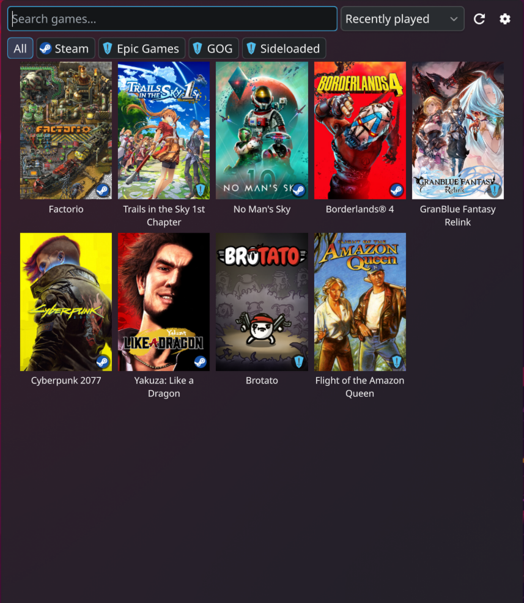

# Game Shelf

I wanted a simple universal launcher for games on my Nobara setup. This was 100% coded using AI.

A KDE Plasma 6 panel widget that shows every installed game from Steam, Heroic and
other launchers in one popup grid, and launches them with a click.



No launcher has to be open, nothing is installed alongside your games, and no
account is involved. Game Shelf reads each launcher's own files and hands the
launch straight back to the launcher that owns the game.

## Features

- **One grid for every launcher.** Steam (including non-Steam shortcuts) and
  Heroic (Epic, GOG, Amazon, sideloaded) today; one Python file per launcher, so
  more can follow.
- **Real cover art**, taken from the launcher's own cache — portrait or landscape
  tiles, with a launcher badge in the corner and Steam's CDN as a fallback when a
  cover is missing locally. A Heroic game also gets its store — Epic, GOG, Amazon
  or sideloaded — in the opposite corner, since one badge cannot say which of the
  four it came from.
- **The launchers themselves, first.** Every launcher Game Shelf found gets a
  tile of its own ahead of the games, with its own cover art, so Steam or Heroic
  is one click away in the same grid. Switch it off under General if you only
  want games.
- **Search as you type.** Start typing anywhere in the popup; every term has to
  match, so `cyber 2077` finds *Cyberpunk 2077*.
- **Filter and sort.** Chips filter by launcher and store; sort by recently
  played, name or time played, with favourites first if you like.
- **Favourites and a hidden list**, both kept per game and both surviving a
  restart.
- **Keyboard-first.** Open, type, arrow, Enter. The whole popup works without a
  mouse, context menu included.
- **Nothing in the way.** The backend is Python standard library only, opens every
  launcher file read-only, and never writes inside Steam, Heroic or Lutris
  directories. Launching goes through the launcher's own URI handler
  (`steam://`, `heroic://`), never a shell command.

## Supported launchers

| Launcher | Status | What it reads |
|---|---|---|
| **Steam** | working | installed games from every library folder, non-Steam shortcuts, artwork, last played and playtime. Native and Flatpak installs. Opens with `steam://open/games`. |
| **Heroic** | working | Epic, GOG, Amazon and sideloaded games, per-store toggles, artwork. Native and Flatpak installs. Opens by running the Heroic binary. |
| **Prism Launcher** | working | the launcher itself only — its tile opens Prism. Native and Flatpak installs. Minecraft instances are not listed yet. |
| **Lutris** | planned | not yet implemented, so it gets no tile of its own yet either |

Launchers that are not installed are simply absent from the list — nothing to
turn off.

## Requirements

- KDE Plasma 6
- Python 3.10 or newer (standard library only — no third-party packages, no pip)

Both are already present on a typical Plasma 6 desktop.

## Install

### From the `.plasmoid` file

Build one with `make package` (or take it from the releases page, once there is
a release to take it from). Then either:

```bash
kpackagetool6 -t Plasma/Applet -i io.github.buqva.gameshelf-0.1.0.plasmoid
```

or, without a terminal: right-click the panel → **Add Widgets…** → **Get New
Widgets** → **Install Widget From Local File…** and pick the `.plasmoid`.

To update later, use `-u` in place of `-i`.

### From source

```bash
git clone https://github.com/buqva/gameshelf.git
cd gameshelf
./install.sh          # installs, or upgrades an existing install
```

### Then add it

Right-click the panel or desktop → **Add Widgets…** → drag **Game Shelf** where
you want it.

### Uninstall

```bash
kpackagetool6 -t Plasma/Applet -r io.github.buqva.gameshelf
```

Favourites, the hidden list and every other setting belong to the widget
instance on your panel, not to a file of Game Shelf's own; removing the widget
removes them. The only thing left behind is a scan cache in
`~/.cache/gameshelf/`, which is safe to delete at any time.

## Using it

Click the panel icon, then click a game to launch it. Right-click a tile (or
press the Menu key) for **Play**, **Add to favourites**, **Hide this game** and
**Open install folder**.

Everything works from the keyboard:

| Key | Does |
|---|---|
| any letter | jumps to the search field and starts searching |
| <kbd>↓</kbd> from the search field | enters the grid |
| <kbd>←</kbd> <kbd>→</kbd> <kbd>↑</kbd> <kbd>↓</kbd> | move the selection |
| <kbd>↑</kbd> from the top row | back to the search field |
| <kbd>Enter</kbd> | launches the selected game — or the first match, straight from the search field |
| <kbd>Menu</kbd> | opens the context menu on the selected tile |
| <kbd>Tab</kbd> | header → filter chips → grid |
| <kbd>Esc</kbd> | clears the search, then the filter, then closes the popup |

## Configuration

Right-click the widget → **Configure Game Shelf…**.

- **General** — panel icon, tile size, portrait or landscape tiles, game titles
  under the tiles, launcher badges, store badges, the filter bar, the launcher
  tiles, sort order, favourites first, whether the popup closes on launch, and
  the Python interpreter to use (only worth touching if `python3` is not on your
  session's `PATH`).
- **Launchers** — one section per launcher, generated from what the backend
  reports: enable or disable it, show games that are not installed, choose
  between an auto-detected, native, Flatpak or custom install, and for Heroic
  switch Epic, GOG, Amazon and sideloaded games on or off individually.
- **Hidden Games** — everything you hid, with a button to bring it back.

## Troubleshooting

Start with the backend's own diagnostics, which is also what a bug report should
carry:

```bash
make doctor
# or, from an installed copy:
python3 ~/.local/share/plasma/plasmoids/io.github.buqva.gameshelf/contents/code/backend/run.py doctor
```

It prints the Python version, every detected launcher root, per-provider game
counts and timings, and any errors — without exposing the contents of your game
files.

| Symptom | Likely cause |
|---|---|
| The grid is empty and `doctor` says **NOT DETECTED** | the launcher is installed somewhere unusual. Set **Installation** to *Custom path* for it in the Launchers page. |
| A game is missing | it may be marked as not installed by its launcher. Turn on *Show games that are not installed* to check, and file a bug with the `doctor` output if it is installed. |
| Nothing happens on click | the launcher's URI handler is not registered. Test it with `xdg-open steam://rungameid/570`. |
| The popup shows an error about `python3` | set the interpreter explicitly in the General page. |
| A game you hid will not come back | the Hidden Games page lists every hidden game. |
| QML changes don't show up after an upgrade | Plasma caches them: `systemctl --user restart plasma-plasmashell`. |

QML messages from the widget in a running panel:

```bash
journalctl --user -f | grep -i gameshelf
```

## Development

```bash
make test           # backend test suite (179 tests, no third-party packages)
make lint           # byte-compile the backend, validate metadata.json and main.xml
make install        # install or upgrade for the current user
make package        # build build/io.github.buqva.gameshelf-<version>.plasmoid
make check-package  # install that archive into a throwaway prefix and run it
make run            # scan and pretty-print the game list
make doctor         # diagnostics
```

The backend is a plain CLI and can be driven from a terminal, with no Plasma
involved:

```bash
python3 package/contents/code/backend/run.py list | python3 -m json.tool
python3 package/contents/code/backend/run.py providers   # settings schemas
python3 package/contents/code/backend/run.py doctor
```

It prints JSON on stdout and nothing else, exits 0 whenever it produced valid
JSON, and isolates launcher failures into an `errors` array rather than dying.

**Layout.** The Python backend lives inside the plasmoid package
(`package/contents/code/backend/`) so `kpackagetool6` installs it with the QML.
The QML is static and renders what the backend produced; filtering and sorting
are in `package/contents/code/gamelist.js`.

**Adding a launcher** means one file in
`package/contents/code/backend/gameshelf/providers/`, a fixture directory, a
`test_<provider>.py`, a settings schema and a row in the table above — no QML
changes, because the Launchers config page builds its form from the schema the
provider declares.

Further reading: `CLAUDE.md` (conventions).

## License

GPL-2.0-or-later. See [LICENSE](LICENSE).

Game artwork shown by the widget belongs to its respective publishers and is read
from the launchers' own caches; none of it is redistributed here.
